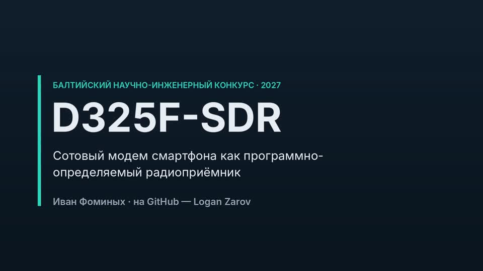

# D325f-SDR — демонстрация

Видео проекта «Сотовый модем смартфона как программно-определяемый радиоприёмник»
(Балтийский научно-инженерный конкурс 2027).

## ▶ [Смотреть видео онлайн](https://loganzarov-alt.github.io/Demo/)

Просмотр в браузере с плеером — без скачивания файла вручную.

Исходный код проекта: https://github.com/loganzarov-alt/D325f-SDR
